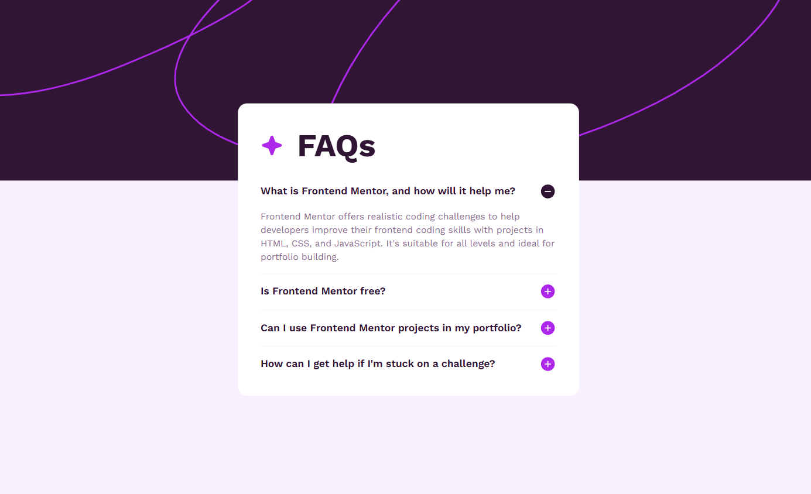
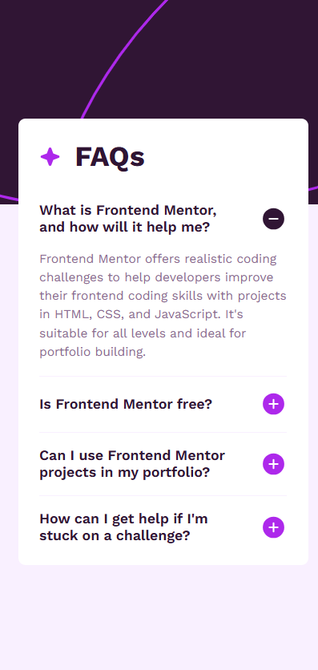

# FAQ Accordion · Frontend Mentor

A frequently asked questions accordion built with HTML, CSS and JavaScript for the [Frontend Mentor FAQ Accordion challenge](https://www.frontendmentor.io/challenges/faq-accordion-wyfFdeBwBz). The goal was to practice semantic structure, responsive design and accessible interaction while understanding each implementation decision.

[Versión en español](./README.md) · [Repository](https://github.com/JesuSaid/FAQ-Accordion)

## Result

### Desktop

### Mobile

## Features

- Expand or collapse each answer by activating its question.
- Navigate with Tab and Shift + Tab and activate buttons with Enter or Space.
- Keep multiple answers open or close all answers independently.
- Show the first answer initially and hide the remaining three.
- Automatically switch between plus and minus icons according to state.
- Adapt the layout to mobile and desktop, with hover and visible focus states.

## Technologies and structure

A static project without frameworks, dependencies or a build step.

| File | Responsibility |
| --- | --- |
| `index.html` | Content, semantic structure, controls and initial states |
| `fonts.css` | Local Work Sans font declarations for weights 400, 600 and 700 |
| `styles.css` | Tokens, mobile-first layout, Grid, Flexbox and visual states |
| `script.js` | Events and synchronization of each answer's state |
| `assets/` | Fonts, SVG backgrounds, icons and result screenshots |

To run the project, download or clone the repository and open `index.html` in a browser. A local static server also works. No package installation is required. The script uses `defer` to execute after the HTML has been parsed.

## Process and lessons learned

### Semantic HTML and native controls

Content is organized inside `main`, with a header containing a single `h1` and a list of questions. Each question uses a button inside an `h2`: the heading provides hierarchy, while the button offers native focus and keyboard activation. `type="button"` explicitly makes it a non-submit control.

The star and action icons use `alt=""` because they are decorative; the question text supplies the button's accessible name. The document uses `lang="en"` because the FAQ content is in English, regardless of this documentation's language.

### Mobile-first design and tokens

Base styles target small screens, and a `min-width: 38rem` media query adds desktop enhancements. The implementation was informed by `style-guide.md`, the visual references and the design recreation in Penpot.

Colors and the font family are centralized as semantic custom properties in `:root`. Fonts are hosted locally with `font-display: swap` and a generic fallback family. Buttons use `font: inherit` and `color: inherit` to match the surrounding typography.

The card uses 24px padding on mobile and 40px on desktop, with a maximum width of 600px in the larger layout. Flexbox handles centering without excessive side margins or fixed heights that could clip answers. Logical properties such as `margin-inline`, `padding-block` and `border-block-end` define spacing and dividers.

### Grid for text and icons

Classes follow BEM, including elements such as `faq__trigger` and modifiers such as `faq__icon--plus`.

Each button uses two columns: `minmax(0, 1fr)` for the question and 30px for the icon. Text is wrapped in a `span`; both icons share the same cell, and CSS displays only the appropriate one. Questions can wrap while the icon stays at the end and vertically centered, without participating in the text baseline.

### JavaScript and accessibility

Each button references its answer through `aria-controls`, matching a unique answer `id`. `aria-expanded` communicates whether the answer is open, while `hidden` controls its actual visibility: ARIA alone does not hide content.

JavaScript selects buttons with `querySelectorAll`, loops over them with `forEach` and registers a `click` event on each one. `event.currentTarget` identifies the button even when its text or icon is clicked; `getAttribute` and `getElementById` locate the associated answer.

The handler compares the state against the string `"true"`, updates `aria-expanded`, and adds or removes `hidden`. CSS reacts to the attribute to switch icons, keeping that visual logic out of JavaScript. Other lessons included declaring variables with `const` and distinguishing strings from booleans: `"false"` is still a non-empty string.

Native buttons already translate Enter and Space into activation, so no extra keyboard handler was added that could toggle the state twice.

### Git and incremental work

Development was divided into milestones: HTML structure, icons and classes, fonts and base styles, mobile layout, desktop adaptation and interaction. Commits were written in English using prefixes such as `feat` and `feat(ui)`, with Git status reviews and whitespace checks using `git diff --check`.

## Checks performed

Manual reviews were carried out during development, with screenshots shared to inspect the results:

- Responsive layouts at 320, 375, 768 and 1440px, plus 607, 608 and 609px around the breakpoint.
- First answer open, all answers open and all answers closed; inspection of wrapping, alignment and access to content by scrolling.
- Mouse and keyboard activation and visible focus review.
- Browser zoom at 200% and 400%, checked manually during the challenge.
- HTML validation without errors or warnings and CSS validation with W3C.
- Manual console and reload checks without observed errors.

These checks are not a complete accessibility audit or automated test suite. When JavaScript is disabled, answers initially marked with `hidden` remain hidden; improving that fallback is a possible next step.

## Further practice

- Progressive enhancement so all content remains available if JavaScript fails to load.
- Screen reader and cross-browser checks.
- Automated interaction and accessibility tests.
- Fluid sizing when it improves clarity and makes transitions between sizes more gradual.

## References and credits

- [Design and style guide in Penpot](https://design.penpot.app/?screen=workspace&team-id=2f1be954-9d1b-812a-8008-e7176a4d30b3&file-id=51f2d744-23b9-8138-8008-ee55742de2de&page-id=b7131c01-4263-8038-8008-ee605b391a46)
- [WAI-ARIA accordion pattern](https://www.w3.org/WAI/ARIA/apg/patterns/accordion/)
- [HTML validator](https://validator.w3.org/nu/) and [CSS validator](https://jigsaw.w3.org/css-validator/)
- Challenge and visual assets provided by Frontend Mentor. Author: [JesuSaid](https://github.com/JesuSaid).

Codex was used to support planning, explain concepts, review progress and draft this documentation. Implementation and manual checks were completed through guided work during the challenge.
