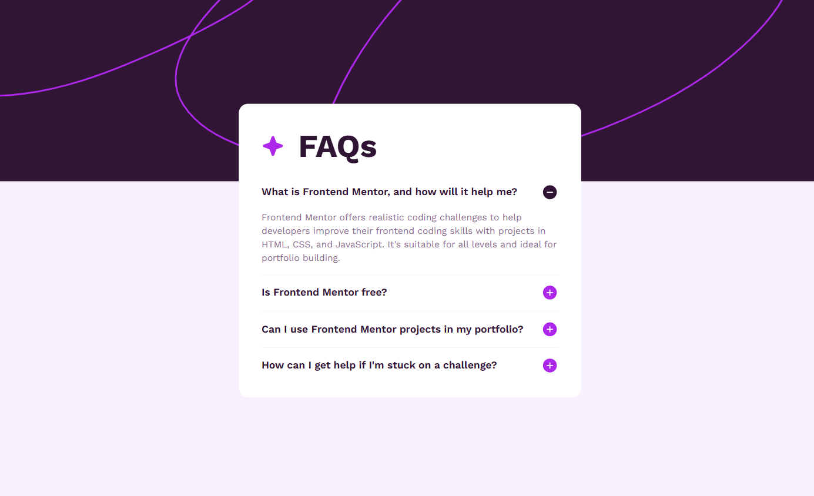
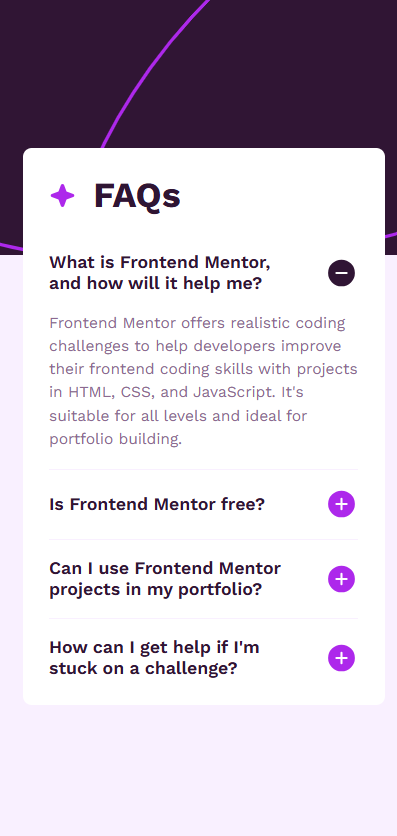

# FAQ Accordion · Frontend Mentor

Acordeón de preguntas frecuentes desarrollado con HTML, CSS y JavaScript como solución al [reto FAQ Accordion de Frontend Mentor](https://www.frontendmentor.io/challenges/faq-accordion-wyfFdeBwBz). El objetivo fue practicar estructura semántica, diseño responsive e interacción accesible, entendiendo cada decisión durante el desarrollo.

[English version](./README-en.md) · [Repositorio](https://github.com/JesuSaid/FAQ-Accordion)

## Resultado

### Escritorio

### Móvil

## Funcionalidades

- Abrir y cerrar cada respuesta pulsando su pregunta.
- Navegar con Tab y Shift + Tab y activar los botones con Enter o Espacio.
- Mantener varias respuestas abiertas o cerrar todas de forma independiente.
- Mostrar inicialmente la primera respuesta y mantener las otras tres ocultas.
- Cambiar automáticamente entre los iconos plus y minus según el estado.
- Adaptar la presentación a móvil y escritorio, con estados de hover y foco visible.

## Tecnologías y organización

Proyecto estático, sin frameworks, dependencias ni proceso de compilación.

| Archivo | Responsabilidad |
| --- | --- |
| `index.html` | Contenido, estructura semántica, controles y estados iniciales |
| `fonts.css` | Declaraciones locales de Work Sans en pesos 400, 600 y 700 |
| `styles.css` | Tokens, diseño mobile-first, Grid, Flexbox y estados visuales |
| `script.js` | Eventos y sincronización del estado de cada respuesta |
| `assets/` | Fuentes, fondos SVG, iconos y capturas del resultado |

Para ejecutarlo, descarga o clona el repositorio y abre `index.html` en un navegador. También puedes utilizar un servidor estático local. No requiere instalación de paquetes. El script se carga con `defer` para ejecutarse después de analizar el HTML.

## Proceso y aprendizajes

### HTML semántico y controles nativos

El contenido se organiza en `main`, un encabezado con un único `h1` y una lista de preguntas. Cada pregunta utiliza un botón dentro de un `h2`: el encabezado aporta jerarquía y el botón ofrece foco y activación nativos con teclado. Se usa `type="button"` para indicar que el control no envía formularios.

La estrella y los iconos tienen `alt=""` porque son decorativos; el texto de la pregunta proporciona el nombre del botón. El documento conserva `lang="en"` porque el contenido de las preguntas está en inglés, independientemente del idioma de este README.

### Diseño mobile-first y tokens

Los estilos base atienden pantallas pequeñas y una media query con `min-width: 38rem` incorpora las mejoras para escritorio. Se consultaron `style-guide.md`, las referencias visuales y la recreación del diseño en Penpot.

Se centralizaron colores y familia tipográfica en propiedades personalizadas semánticas dentro de `:root`. Las fuentes se sirven localmente con `font-display: swap` y una familia genérica de respaldo. Los botones usan `font: inherit` y `color: inherit` para integrarse con la tipografía del contenido.

La tarjeta utiliza padding de 24px en móvil y 40px en escritorio, con un ancho máximo de 600px en la vista grande. El centrado depende de Flexbox, sin márgenes laterales excesivos ni alturas fijas que recorten respuestas. Propiedades lógicas como `margin-inline`, `padding-block` y `border-block-end` expresan espacios y divisores.

### Grid para texto e iconos

Las clases siguen BEM, con elementos como `faq__trigger` y modificadores como `faq__icon--plus`.

Cada botón usa dos columnas: `minmax(0, 1fr)` para la pregunta y 30px para el icono. El texto se agrupa en un `span`; ambos iconos ocupan la misma celda y CSS muestra solo el correspondiente. Así, una pregunta puede ocupar varias líneas mientras el icono permanece al extremo y centrado verticalmente, sin participar en la línea base del texto.

### JavaScript y accesibilidad

Cada botón se relaciona con su respuesta mediante `aria-controls`, cuyo valor coincide con un `id` único. `aria-expanded` comunica si la respuesta está abierta y `hidden` controla su visibilidad real: ARIA por sí solo no oculta contenido.

JavaScript selecciona los botones con `querySelectorAll`, los recorre con `forEach` y registra un evento `click` en cada uno. `event.currentTarget` identifica el botón aunque se pulse el texto o el icono; `getAttribute` y `getElementById` permiten localizar la respuesta asociada.

El manejador compara el estado con la cadena `"true"`, actualiza `aria-expanded` y añade o elimina `hidden`. CSS responde al atributo para cambiar el icono, evitando duplicar esa lógica en JavaScript. Se aprendió también a declarar variables con `const` y a distinguir cadenas de booleanos: `"false"` sigue siendo una cadena no vacía.

Los botones nativos ya convierten Enter y Espacio en activación, por lo que no se añadió un manejador de teclado que pudiera alternar dos veces el estado.

### Git y trabajo por etapas

El desarrollo se dividió en hitos: estructura HTML, iconos y clases, fuentes y estilos base, diseño móvil, adaptación a escritorio e interacción. Se utilizaron commits en inglés con prefijos como `feat` y `feat(ui)`, revisando el estado de Git y los espacios sobrantes con `git diff --check`.

## Comprobaciones realizadas

Durante el desarrollo se realizaron revisiones manuales y se compartieron capturas de los resultados:

- Responsive a 320, 375, 768 y 1440px, además de 607, 608 y 609px alrededor del breakpoint.
- Primera respuesta abierta, todas abiertas y todas cerradas; revisión de ajuste del texto, alineación y acceso al contenido mediante desplazamiento.
- Activación con ratón y teclado y revisión del foco visible.
- Zoom al 200% y 400%, comprobado manualmente durante el reto.
- Validación del HTML sin errores ni advertencias y validación de CSS con W3C.
- Revisión manual de consola y recarga sin errores observados.

Estas comprobaciones no equivalen a una auditoría completa de accesibilidad ni a pruebas automatizadas. Con JavaScript desactivado, las respuestas marcadas inicialmente con `hidden` permanecen ocultas; mejorar ese comportamiento es una posible evolución.

## Qué seguir practicando

- Mejora progresiva para que todo el contenido siga disponible si JavaScript no carga.
- Comprobaciones con lectores de pantalla y distintos navegadores.
- Pruebas automatizadas de interacción y accesibilidad.
- Medidas fluidas cuando aporten claridad y una transición más gradual entre tamaños.

## Referencias y créditos

- [Diseño y guía en Penpot](https://design.penpot.app/?screen=workspace&team-id=2f1be954-9d1b-812a-8008-e7176a4d30b3&file-id=51f2d744-23b9-8138-8008-ee55742de2de&page-id=b7131c01-4263-8038-8008-ee605b391a46)
- [Patrón de acordeón de WAI-ARIA](https://www.w3.org/WAI/ARIA/apg/patterns/accordion/)
- [Validador de HTML](https://validator.w3.org/nu/) y [validador de CSS](https://jigsaw.w3.org/css-validator/)
- Reto y recursos visuales proporcionados por Frontend Mentor. Autor: [JesuSaid](https://github.com/JesuSaid).

Se utilizó Codex como apoyo para planificar etapas, explicar conceptos, revisar avances y redactar esta documentación. La implementación y las comprobaciones manuales se trabajaron de forma guiada durante el reto.
